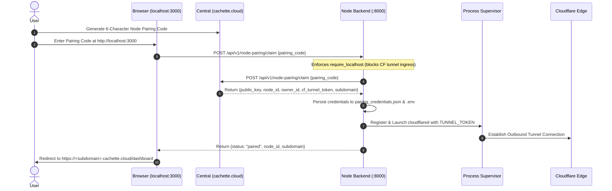

# Cachette Node

> **Turn any PC, laptop, or server into your own internet-accessible personal cloud storage.**

Cachette is a decentralized, self-hosted personal cloud storage platform. It decouples the control plane (**Central** at [cachette.cloud](https://cachette.cloud)) from your local hardware (**Node**), giving you S3-compatible cloud storage with public HTTPS access—**zero Docker, zero port-forwarding, zero dynamic DNS, and zero central byte storage**.

---

## Table of Contents

1. [What's Changed Since Last Update (Changelog)](#whats-changed-since-last-update-changelog)
2. [System Architecture](#system-architecture)
3. [Key Architectural Highlights](#key-architectural-highlights)
4. [Technology Stack](#technology-stack)
5. [Quick Start & Automated Setup](#quick-start--automated-setup)
6. [Manual Installation & Development](#manual-installation--development)
7. [Core Workflows & Security Model](#core-workflows--security-model)
   - [1. First-Time Node Pairing Workflow](#1-first-time-node-pairing-workflow)
   - [2. Native Binary Lifecycle & Supervision](#2-native-binary-lifecycle--supervision)
   - [3. Resilient File Upload Workflow (Single, Multipart & Disk Capacity Guard)](#3-resilient-file-upload-workflow)
   - [4. Public File Sharing & Streaming Workflow](#4-public-file-sharing--streaming-workflow)
   - [5. Security Model: Auth-by-Default & Node Access Contract](#5-security-model-auth-by-default--node-access-contract)
   - [6. In-Memory Token Bucket Rate Limiting](#6-in-memory-token-bucket-rate-limiting)
8. [API Endpoint Reference](#api-endpoint-reference)
   - [System & Health](#system--health)
   - [Identity & User Profile](#identity--user-profile)
   - [Node Pairing & Tunnel Lifecycle](#node-pairing--tunnel-lifecycle)
   - [File & Directory Management (`/api/v1/files`)](#file--directory-management-apiv1files)
   - [Public File Sharing](#public-file-sharing)
   - [Explicit Unauthenticated Allowlist](#explicit-unauthenticated-allowlist)
9. [Configuration & Environment Variables](#configuration--environment-variables)
10. [Automated Testing & Verification](#automated-testing--verification)

---

## What's Changed Since Last Update (Changelog)

A comprehensive hardening update was applied to the backend runtime, authentication layer, and pairing subsystem:

### 1. "Auth by Default" Architecture & Legacy Route Removal
- **Global Authenticated Router**: All API endpoints under `/api/v1` (with the exception of an explicit allowlist) now inherit mandatory RS256 token verification via `get_current_node_user`.
- **Elimination of Mock Auth Stubs**: Removed dead stub endpoints (`POST /signup`, `POST /api/v1/auth/signup`, `POST /login`, `POST /api/v1/auth/login`, `POST /refresh`, `POST /api/v1/auth/refresh`). The node does not process credentials or manage user passwords—all authentication originates from Central.
- **Unified Identity Endpoint**: Mounted `GET /api/v1/me`, `GET /api/v1/auth/me`, and fallback `GET /me` under authenticated dependencies, returning user quota, storage used, and verified role (`owner` | `member`).

### 2. Strict `node_access` JWT Contract & RBAC
- **Token Contract Verification**: All authenticated requests require a Central-issued RS256 JWT with claim `type == "node_access"`. Generic access or share tokens are rejected with `401 Unauthorized`.
- **Node Audience Pinning (`aud`)**: The token's `aud` claim must match the local node's `node_id`. If the token is targeted for another node, access is rejected with `403 Forbidden`.
- **Role-Based Access Control (`role`)**: Supported roles are `"owner"` and `"member"`. If role is `"owner"`, the user's `sub` UUID must strictly match the node's configured `owner_id`.
- **Fail-Closed Guarantees**: If a node lacks a configured `node_id` or `owner_id` (e.g. uninitialized pairing), all protected endpoints immediately fail closed with `403 Forbidden`.
- **Dynamic JWKS Key Resolution**: Tokens extract `kid` headers and match against cached Central JWKS keys. Verification uses `verify_aud: False` in the cryptographic layer to enable strict manual audience matching against local node configuration.
- **Cross-User Data Isolation**: Files and folders are strictly partitioned by `owner_id == current_user.id`. Users cannot view, download, rename, or delete each other's files.
- **Owner-Restricted Public Sharing**: Public link generation (`POST /api/v1/files/{file_id}/share`) is guarded by the new `require_owner` dependency. Non-owner members receive `403 Forbidden`.

### 3. Localhost Protection & Tunnel Ingress Isolation
- **Loopback Enforcement (`require_localhost`)**: Sensitive operational endpoints (`POST /api/v1/node-pairing/claim` and `POST /api/v1/node-pairing/tunnel/restart`) are restricted strictly to loopback (`127.0.0.1`, `::1`, `localhost`).
- **Cloudflare Header Anti-Spoofing**: Ingress checks inspect `cf-connecting-ip` and `cf-ray`. If present, requests arriving over Cloudflare Tunnel are classified as non-local and denied `403 Forbidden`.
- **Sanitized Remote Status**: `GET /api/v1/node-pairing/status` sanitizes its output for remote callers over the tunnel, exposing only `{paired: bool, tunnel_ready: bool}` without leaking internal node IDs, subdomains, error details, or supervisor metadata.
- **Stateless Pairing (Removal of Persistent `session_token`)**: Node pairing credentials (`pairing_credentials.json`) no longer store or return a static `session_token` or `session_token_expires_at`. The node instead captures and persists `owner_id`.

### 4. Tunnel Concurrency Locking & Dedicated Rate Limiting
- **Restart Lock (`_restart_lock`)**: An `asyncio.Lock` and task reference ensure only one tunnel restart workflow runs at any time. Concurrent trigger attempts return `409 Conflict ("Tunnel restart already in progress")`.
- **Tunnel Restart Rate Limiter**: Introduced `tunnel_restart_limiter` (capacity 3, refill rate 0.05/sec $\approx$ 1 request per 20 seconds, key prefix `ratelimit:tunnel:restart`) to prevent abuse of the tunnel lifecycle.
- **Rate Limiter Store Reset**: Added `clear()` method to `Token_Bucket_Rate_Limiter` for testing and operational state resets.

### 5. Physical Storage Capacity Protection & Route Typo Fix
- **Node-Wide Disk Capacity Check**: `POST /api/v1/files/uploads/initiate` validates both the user's quota and physical host disk capacity via `shutil.disk_usage(storage_path)`. If available disk space is insufficient, the upload is rejected with `413 ("Node storage capacity exceeded: Insufficient disk space on node")`.
- **Upload Endpoint Typo Fix**: Added properly spelled route `POST /api/v1/files/uploads/initiate`, while retaining `POST /api/v1/files/uploads/initate` as a hidden deprecated alias for backwards compatibility.

### 6. Expanded Automated Test Suites
- Added `backend/tests/test_owner_member_auth.py` covering audience mismatch rejection, token expiration, owner-only authorization, user isolation, fail-closed handling, and automated route allowlist enforcement.
- Added `backend/tests/test_pairing_security.py` validating loopback constraints, header spoofing protection, unauthenticated session rejection, and tunnel restart concurrency locks.

---

## System Architecture

```mermaid
flowchart TB
    subgraph WAN ["Internet Ingress (Zero Port-Forwarding)"]
        Browser["User Browser / Client"]
        Central["Cachette Central (cachette.cloud)"]
        CFEdge["Cloudflare Edge (HTTPS Ingress)"]
    end

    subgraph NodeHost ["User Local PC / Node Host (Native Windows / Linux)"]
        subgraph Supervisor ["Process Supervisor (In-Process)"]
            Cloudflared["cloudflared (Native Binary)\n[Outbound Tunnel to Cloudflare Edge]"]
            MinIO["MinIO (Native S3 Binary)\n[Port 9002 API / 9003 Console]"]
        end

        subgraph Application ["Cachette Application Stack"]
            Frontend["Next.js Web UI\n[Port 3000]"]
            Backend["FastAPI Node Backend\n[Port 8000]"]
            RateLimiter["In-Memory Rate Limiter\n[32 Shards, Lazy Refill, LRU, TTL Pruning]"]
            SQLite["SQLite Database (WAL Mode)\n[cachette.db]"]
        end

        subgraph LocalDisk ["Local Persistent Data (/data)"]
            BinDir["/data/bin (minio.exe, cloudflared.exe)"]
            MinIODir["/data/minio (Encrypted/Stored Object Chunks)"]
            LogDir["/data/logs (Rotating minio.log, cloudflared.log)"]
        end
    end

    Browser -->|Public HTTPS Request| CFEdge
    Central -->|Node Pairing Code & JWKS| Frontend
    CFEdge <-->|Outbound QUIC/HTTP2 Tunnel| Cloudflared
    Cloudflared -->|Local Ingress Proxy| Frontend
    Frontend <-->|REST API Calls| Backend
    Backend <-->|CRUD Queries| SQLite
    Backend <-->|Rate Limit Verification| RateLimiter
    Backend <-->|Stream File Bytes (aioboto3)| MinIO
    Supervisor -.->|Spawn, Monitor, Auto-Restart| Cloudflared
    Supervisor -.->|Spawn, Monitor, Auto-Restart| MinIO
    MinIO -->|Persist S3 Objects| MinIODir
    Supervisor -->|Capture Logs| LogDir
```

---

## Key Architectural Highlights

- **Zero Docker Native Execution**: Operates natively on Windows and Linux without container virtualization overhead. Pinned native binaries for MinIO and Cloudflare Tunnel (`cloudflared`) are managed entirely in-process by Cachette.
- **In-Process Process Supervisor**: The `ProcessManager` runtime provides automatic crash detection, exponential backoff restarts, readiness health probes, log rotation to disk, secret isolation, and process-group orphan prevention.
- **Zero Port-Forwarding Ingress**: Uses an outbound-only Cloudflare Tunnel (`cloudflared`). Central provisions a dedicated public subdomain (`https://<your-subdomain>.cachette.cloud`) routing directly to your node without router configuration or static IPs.
- **Cryptographic Trust & Auth-by-Default**: Incoming requests are validated using Central's RS256 RSA public keys and local JWKS caching. No passwords, user hashes, or email engines are stored on the node.
- **Direct S3 Streaming**: User files stream directly into the local MinIO object store using single-part or multipart (10 MB chunked) uploads with automatic resumability.
- **High-Performance In-Memory Rate Limiting**: Sharded token bucket rate limiter (32 shards, configurable) using `time.monotonic()`, lazy refills on access, background TTL pruning of idle-full buckets, and strict LRU bounds.

---

## Technology Stack

- **Backend**: [FastAPI](https://fastapi.tiangolo.com/) (Python 3.12), [SQLAlchemy 2.0](https://www.sqlalchemy.org/) & [Alembic](https://alembic.sqlalchemy.org/), [aiosqlite](https://github.com/omnilib/aiosqlite) (SQLite in WAL mode), [aioboto3](https://github.com/terrycain/aioboto3), [psutil](https://github.com/giampaolo/psutil).
- **Frontend**: [Next.js](https://nextjs.org/) (React 19, Turbopack, Tailwind CSS, Lucide & Remix Icons, Framer Motion).
- **Native Runtime**: Pinned [MinIO](https://min.io/) (`RELEASE.2025-06-13T11-33-47Z`) and [Cloudflare Tunnel](https://developers.cloudflare.com/cloudflare-one/connections/connect-networks/) (`2026.10.7`) managed by Cachette's native supervisor.

---

## Quick Start & Automated Setup

### Prerequisites
- **Python 3.10+** (Python 3.12 recommended)
- **Node.js 18+** & **npm** or **pnpm**
- *(No Docker or Redis required!)*

### Automated Setup Scripts

The automated setup scripts create your environment files, set up Python venvs, run database migrations, and install frontend dependencies:

#### On Windows (PowerShell):
```powershell
.\setup.ps1
```

#### On Linux / macOS:
```bash
chmod +x setup.sh
./setup.sh
```

### Launching the Node

Open two terminals:

```bash
# Terminal 1: Backend API (MinIO is automatically fetched, verified, and started)
cd backend
# Windows: .\.venv\Scripts\Activate.ps1 | Linux: source .venv/bin/activate
uvicorn app.main:app --port 8000

# Terminal 2: Frontend Web UI
cd frontend
npm run dev
```

---

## Core Workflows & Security Model

### 1. First-Time Node Pairing Workflow



1. Open **`http://localhost:3000`** in your browser.
2. Log into [cachette.cloud](https://cachette.cloud), go to **Nodes**, and generate a **Node Pairing Code**.
3. Enter the pairing code in the local UI.
4. The node backend exchanges the code with Central, saves cryptographic credentials (`node_id`, `owner_id`, `public_key`, `cf_tunnel_token`) locally, launches the native `cloudflared` tunnel, and establishes your live public URL at **`https://<your-subdomain>.cachette.cloud`**.

---

### 2. Native Binary Lifecycle & Supervision

The supervisor (`app.runtime`) manages native binaries without third-party process monitors:

1. **Manifest Pinning & Verification (`manifest.py`, `downloader.py`)**:
   - Binaries are pinned by release tag and strict SHA256 checksums across Windows amd64 and Linux amd64/arm64.
   - Downloads write to atomic temporary files (`.tmp`) and rename to final destinations (`data/bin/`) only after SHA256 passes.
   - If an existing binary matches the checksum, download is skipped.
2. **Execution & Stealth Isolation (`supervisor.py`)**:
   - On Windows, subprocesses launch with `CREATE_NO_WINDOW | CREATE_NEW_PROCESS_GROUP` to suppress command prompt popups.
   - On Linux, subprocesses use `os.setsid` for independent process group management.
   - Secrets (`MINIO_ROOT_USER`, `MINIO_ROOT_PASSWORD`, `TUNNEL_TOKEN`) are injected strictly into `process.env` and never exposed in command arguments or logs.
3. **Resilience & Crash Recovery**:
   - Background monitor loop evaluates process liveness every tick.
   - Unexpected exits trigger exponential backoff: `1.0s -> 2.0s -> 4.0s -> 8.0s -> 16.0s -> 30.0s` (up to 5 restarts in a 5-minute window).
4. **Clean Termination & Orphan Prevention**:
   - On application shutdown, processes receive `SIGTERM` / `terminate()`, followed by a 5-second timeout before `kill()`.
   - Full process trees are reaped via `psutil`. An `atexit` hook guarantees zero zombie or orphaned processes on application exit or crash.

---

### 3. Resilient File Upload Workflow

```mermaid
flowchart TD
    Start["Client Initiates Upload"] --> Init["POST /api/v1/files/uploads/initiate\n(Check Max File Size & Name Collision)"]
    Init --> QuotaCheck{"Check User Storage Quota\n(storage_used + size <= quota)"}
    QuotaCheck -->|Exceeded| QuotaFail["Reject 413: Storage quota exceeded"]
    QuotaCheck -->|Passed| DiskCheck{"Check Node Physical Disk Capacity\n(size <= free_disk_bytes)"}
    DiskCheck -->|Insufficient| DiskFail["Reject 413: Node storage capacity exceeded"]
    DiskCheck -->|Passed| CheckSize{"File Size >= 5 MB?"}

    CheckSize -->|No (< 5 MB)| SingleMode["Single Upload Mode"]
    SingleMode --> SingleUpload["POST /api/v1/files/{file_id}/upload\n(Stream body directly to MinIO)"]
    SingleUpload --> CompleteSingle["Update File Status = active\nIncrement storage_used in SQLite"]

    CheckSize -->|Yes (>= 5 MB)| MultiMode["Multipart Chunked Mode"]
    MultiMode --> ChunkLoop["Split file into 10 MB Chunks"]
    ChunkLoop --> UploadPart["PUT /api/v1/files/uploads/{file_id}/part?part_number=N\n(Streams chunk to MinIO, returns ETag)"]
    UploadPart --> MoreChunks{"More Chunks?"}
    MoreChunks -->|Yes| ChunkLoop
    MoreChunks -->|No| CompleteMulti["POST /api/v1/files/uploads/{file_id}/complete\n(Commit parts with ETags to MinIO)"]
    CompleteMulti --> Finalize["Update File Status = active\nIncrement storage_used in SQLite"]
```

---

### 4. Public File Sharing & Streaming Workflow

Cachette supports two sharing patterns:

1. **Local Node Slugs (`/s/{slug}`)**:
   - Node generates a collision-free, non-sequential cryptographic slug.
   - **Generation restricted to Node Owner**: Members cannot create share links.
   - Direct access without central token validation.
   - Streams directly from MinIO: `inline` disposition for viewing or `attachment` for downloading.
2. **Central-Authorized Shares (`/api/v1/shared/{resource_id}?token=...`)**:
   - Token is an RS256 JWT generated by Central.
   - Node validates signature using cached JWKS public keys.
   - Verifies claims (`res_id` matching `resource_id`, `node_id` matching own ID, not expired).
   - Rejects `node_access` tokens on this route to maintain separation of concerns.
   - Returns generic 404 on any failure without leaking resource state.

---

### 5. Security Model: Auth-by-Default & Node Access Contract

| Security Boundary | Policy & Implementation | Failure Behavior |
|---|---|---|
| **Default Router Auth** | Mounted on `APIRouter(prefix="/api/v1", dependencies=[Depends(get_current_node_user)])`. All routes require auth unless explicitly allowlisted. | `401 Unauthorized` |
| **Token Contract** | Requires claim `type == "node_access"`. | `401 Unauthorized` |
| **Node Audience Pinning** | Token claim `aud == node_id`. Tokens issued for other nodes are rejected. | `403 Forbidden` |
| **Role Verification** | Token claim `role in ("owner", "member")`. If `role == "owner"`, `sub` must match node's configured `owner_id`. | `403 Forbidden` |
| **Fail-Closed Missing Config**| If node is unconfigured (`node_id` or `owner_id` missing), all requests are rejected. | `403 Forbidden` |
| **Localhost Isolation** | Endpoints marked `require_localhost` reject any requests carrying `cf-connecting-ip` or `cf-ray`. | `403 Forbidden` |
| **Tunnel Concurrency Guard**| Tunnel restart uses `_restart_lock` and task state. Simultaneous restarts are blocked. | `409 Conflict` |
| **Cross-User File Isolation**| File and folder lookups filter by `owner_id == current_user.id`. | `404 Not Found` |
| **Share Link Generation** | Restricted strictly to `current_user.role == "owner"` via `require_owner`. | `403 Forbidden` |

---

### 6. In-Memory Token Bucket Rate Limiting

Rate limiting is fully in-process with zero Redis dependency:

- **Sharded Architecture**: 32 independent shards (`hash(key) % 32`), each protected by a dedicated `threading.Lock` and `collections.OrderedDict`.
- **Lazy Refills**: Token counts update on demand using `time.monotonic()`:
  $$\text{tokens} = \min\left(\text{capacity}, \text{tokens} + \Delta t \times \text{refill\_rate}\right)$$
- **Atomicity**: The check-and-decrement operation is indivisible with no `await` statements inside the critical section, ensuring thread safety.
- **Automated TTL Pruning**: A bucket that has remained idle for at least $\frac{\text{capacity}}{\text{refill\_rate}}$ seconds is guaranteed full. A background lifespan task periodically sweeps one shard at a time, removing idle-full entries to prevent memory leaks.
- **LRU Memory Cap**: When a shard exceeds `max_keys_per_shard` (default: 10,000), the least recently accessed key is evicted.
- **Active Limiters**:
  - `general_limiter`: Per-user operations (capacity 60, refill 1.0/sec).
  - `shared_limiter`: Public file streaming (capacity 30, refill 0.5/sec).
  - `tunnel_restart_limiter`: Supervised tunnel restarts (capacity 3, refill 0.05/sec $\approx$ 1 per 20s).
- **HTTP 429 Responses**: Returns `Retry-After` header with the exact ceiling seconds needed to refill tokens.

---

## API Endpoint Reference

### System & Health

| Method | Endpoint | Auth | Rate Limit | Description |
|---|---|---|---|---|
| `GET` | `/health` | None (Allowlisted) | None | Node liveness and health probe. |

### Identity & User Profile

| Method | Endpoint | Auth | Rate Limit | Description |
|---|---|---|---|---|
| `GET` | `/api/v1/me` | Bearer (`node_access`) | General Limiter (User) | Returns caller identity, role (`owner` \| `member`), and storage quota stats. |
| `GET` | `/api/v1/auth/me` | Bearer (`node_access`) | General Limiter (User) | Alias for `/api/v1/me`. |
| `GET` | `/me` | Bearer (`node_access`) | General Limiter (User) | Root-level alias for backward compatibility. |

### Node Pairing & Tunnel Lifecycle

| Method | Endpoint | Auth | Constraints | Description |
|---|---|---|---|---|
| `POST` | `/api/v1/node-pairing/claim` | None (Allowlisted) | **Localhost Only** (`require_localhost`) | Exchanges 6-char pairing code with Central, persists keys & `owner_id`, and triggers native `cloudflared`. |
| `GET` | `/api/v1/node-pairing/status` | None (Allowlisted) | Sanitized on Remote | Reports pairing and tunnel status. Remote tunnel requests receive `{paired, tunnel_ready}`; localhost receives full diagnostic state. |
| `GET` | `/api/v1/node-pairing/session` | Bearer (`node_access`) | Authenticated Default | Returns active node pairing metadata, user quota/role, and live tunnel readiness. |
| `POST` | `/api/v1/node-pairing/tunnel/restart` | None (Allowlisted) | **Localhost Only**, Rate Limited | Triggers supervised restart of `cloudflared`. Concurrency-locked (`409 Conflict` if running). Guarded by `tunnel_restart_limiter`. |

### File & Directory Management (`/api/v1/files`)

*All routes in this group require Bearer authentication (`get_current_node_user`) with `type == "node_access"`.*

| Method | Endpoint | Role Required | Rate Limit | Description |
|---|---|---|---|---|
| `POST` | `/api/v1/files/uploads/initiate` | Owner / Member | General Limiter | Initiates upload; validates user quota and node-wide physical disk capacity. |
| `POST` | `/api/v1/files/uploads/initate` | Owner / Member | General Limiter | *(Deprecated alias)* Same as `/uploads/initiate`. |
| `POST` | `/api/v1/files/{file_id}/upload` | Owner / Member | General Limiter | Streams single-part file payload directly into local MinIO storage. |
| `PUT` | `/api/v1/files/uploads/{file_id}/part` | Owner / Member | General Limiter | Uploads an individual multipart binary chunk (query param: `part_number`). |
| `POST` | `/api/v1/files/uploads/{file_id}/part-url` | Owner / Member | General Limiter | Generates presigned S3 URL for direct chunk upload. |
| `POST` | `/api/v1/files/uploads/{file_id}/complete` | Owner / Member | General Limiter | Commits multipart upload with part numbers & ETags, activating file. |
| `POST` | `/api/v1/files/upload/{file_id}/abort` | Owner / Member | General Limiter | Cancels multipart upload and deletes temporary object fragments. |
| `GET` | `/api/v1/files` | Owner / Member | General Limiter | Lists directory items (files & subfolders) owned by current user; optional `folder_id`. |
| `GET` | `/api/v1/files/{file_id}` | Owner / Member | General Limiter | Fetches file metadata by ID (isolated to file owner). |
| `GET` | `/api/v1/files/{file_id}/download` | Owner / Member | General Limiter | Streams file bytes directly from MinIO as an attachment. |
| `PATCH` | `/api/v1/files/{file_id}` | Owner / Member | General Limiter | Renames an existing file (checks for duplicate names in target folder). |
| `DELETE` | `/api/v1/files/{file_id}` | Owner / Member | General Limiter | Deletes file from MinIO and database; recalculates used quota. |
| `POST` | `/api/v1/files/folders` | Owner / Member | General Limiter | Creates a new folder (optional `parent_id` for nested folders). |
| `PATCH` | `/api/v1/files/folders/{folder_id}` | Owner / Member | General Limiter | Renames an existing folder. |
| `DELETE` | `/api/v1/files/folders/{folder_id}` | Owner / Member | General Limiter | Recursively deletes folder, nested subfolders, and all contained files. |
| `POST` | `/api/v1/files/{file_id}/share` | **Owner Only** (`require_owner`) | General Limiter | Generates or fetches public slug share link (`access_level: "view" \| "download"`). |

### Public File Sharing

| Method | Endpoint | Auth | Rate Limit | Description |
|---|---|---|---|---|
| `GET` | `/s/{slug}`<br>`/api/v1/s/{slug}` | None (Allowlisted) | Shared Limiter (IP) | Streams shared file using node-generated random slug. Inline view or attachment download. |
| `GET` | `/api/v1/shared/{resource_id}` | Query `token` (Allowlisted) | Shared Limiter (IP) | Streams shared file using Central-issued RS256 token verified against Central JWKS. |

### Explicit Unauthenticated Allowlist

Only the following 6 route patterns are exempt from default Bearer token authentication:

1. `GET /health` — Health and liveness probe.
2. `GET /api/v1/node-pairing/status` — Pairing state and tunnel status (remote callers receive sanitized summary).
3. `POST /api/v1/node-pairing/claim` — Initial bootstrap pairing (restricted to `localhost`).
4. `POST /api/v1/node-pairing/tunnel/restart` — Supervised tunnel restart (restricted to `localhost`).
5. `GET /s/{slug}` & `GET /api/v1/s/{slug}` — Public slug-based file downloads and inline previews.
6. `GET /api/v1/shared/{resource_id}` — Central-authorized share streaming via `?token=...` query parameter.

---

## Configuration & Environment Variables

Environment variables are loaded from `.env` in the root and `backend/.env`.

| Variable | Default Value | Description |
|---|---|---|
| `DATABASE_URL` | `sqlite+aiosqlite:///./cachette.db` | Async SQLite database connection string. |
| `NODE_ID` | *(Populated during pairing)* | Unique UUID identifying this local node. |
| `OWNER_ID` | *(Populated during pairing)* | User UUID of the node owner from Central. |
| `S3_ENDPOINT_URL` | `http://127.0.0.1:9002` | Native MinIO S3 API endpoint. |
| `AWS_ACCESS_KEY_ID` | `minioadmin` | S3 root access key. |
| `AWS_SECRET_ACCESS_KEY` | `minioadmin` | S3 root secret key. |
| `AWS_REGION` | `us-east-1` | S3 signing region. |
| `S3_BUCKET_NAME` | `cachette-files` | Target bucket name. |
| `CENTRAL_URL` | `https://cachette.cloud` | Cachette Central control plane endpoint. |
| `CENTRAL_JWKS_URL` | `https://cachette.cloud/api/v1/auth/.well-known/jwks.json` | Remote JWKS keyset endpoint for token verification. |
| `CACHETTE_DATA_DIR` | `<project_root>/data` | Root path for native binaries, logs, and MinIO storage. |
| `MINIO_PORT` | `9002` | Local TCP port for MinIO S3 API. |
| `MINIO_CONSOLE_PORT` | `9003` | Local TCP port for MinIO Web Console. |
| `AUTO_DOWNLOAD_BINARIES` | `true` | When true, fetches and verifies native binaries automatically. |
| `MULTIPART_THRESHOLD` | `5242880` (5 MB) | Files larger than this threshold use chunked multipart uploads. |
| `MAX_FILE_SIZE` | `53687091200` (50 GB) | Hard ceiling for individual file uploads. |
| `RATE_LIMIT_SHARDS` | `32` | Number of distinct concurrency shards in the rate limiter. |
| `RATE_LIMIT_SWEEP_INTERVAL_SECONDS` | `60.0` | Sweep frequency for idle-full token bucket garbage collection. |
| `RATE_LIMIT_MAX_KEYS_PER_SHARD` | `10000` | Max entries per shard before LRU eviction triggers. |
| `CF_TUNNEL_TOKEN` | *(Populated during pairing)* | Cloudflare Tunnel authentication token. |

---

## Automated Testing & Verification

The test suite validates cryptographic authentication, database operations, the native process supervisor, and rate limiting with zero external service dependencies.

### Running Pytest

```bash
cd backend
# Windows:
.\.venv\Scripts\python.exe -m pytest tests -v
# Linux / macOS:
pytest tests -v
```

### Full Verification Checklist

| Test Suite | Coverage |
|---|---|
| `tests/test_owner_member_auth.py` | Audience pinning (`aud`), expired tokens, member vs owner route permissions, user data isolation, fail-closed handling on missing config, tunnel proxy header blocking, and automated router allowlist verification. |
| `tests/test_pairing_security.py` | Localhost loopback enforcement, Cloudflare Tunnel ingress blocking on admin endpoints, unauthenticated session denial, non-owner role spoofing rejection, and tunnel restart concurrency locks. |
| `tests/test_runtime.py` | Platform detection, SHA256 verification, corrupted binary rejection, port collision detection, subprocess lifecycle, exponential backoff crash recovery, and rotating log capture. |
| `tests/test_rate_limiter.py` | Capacity exhaustion, lazy refill over monotonic time, concurrency stress tests, LRU eviction, idle-full bucket pruning, tunnel restart rate limiting, and lifespan sweeper lifecycle. |
| `tests/test_auth.py` | RS256 token verification, signature tampering rejection, token expiration, user cache role population, and pairing credentials persistence. |
| `tests/test_node_shares.py` | Creation, deduplication, owner authorization verification, and streaming of public slug-based shares (`/s/{slug}`). |
| `tests/test_shares.py` | Remote Central JWKS verification, RS256 share tokens, and rotated key caching. |
| `tests/test_sqlite_db.py` | SQLite connection, foreign keys, UUID handling, and WAL mode configuration. |
| `tests/test_tunnel.py` | Token extraction, `.env` file persistence, native tunnel startup workflow, and health reporting. |
