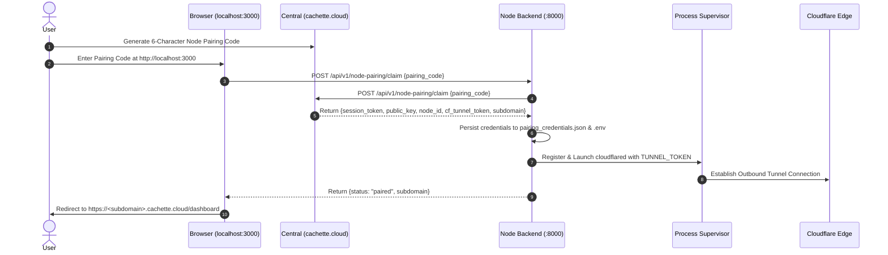

# Cachette Node

> **Turn any PC, laptop, or server into your own internet-accessible personal cloud storage.**

Cachette is a decentralized, self-hosted personal cloud storage platform. It decouples the control plane (**Central** at [cachette.cloud](https://cachette.cloud)) from your local hardware (**Node**), giving you S3-compatible cloud storage with public HTTPS access—**zero Docker, zero port-forwarding, zero dynamic DNS, and zero central byte storage**.

---

## Table of Contents

1. [System Architecture](#system-architecture)
2. [Key Architectural Highlights](#key-architectural-highlights)
3. [Technology Stack](#technology-stack)
4. [Quick Start & Automated Setup](#quick-start--automated-setup)
5. [Manual Installation & Development](#manual-installation--development)
6. [Core Workflows](#core-workflows)
   - [1. First-Time Node Pairing](#1-first-time-node-pairing-workflow)
   - [2. Native Binary Lifecycle & Supervision](#2-native-binary-lifecycle--supervision)
   - [3. Resilient File Upload Workflow (Single & Multipart)](#3-resilient-file-upload-workflow)
   - [4. Public File Sharing & Streaming Workflow](#4-public-file-sharing--streaming-workflow)
   - [5. In-Memory Token Bucket Rate Limiting](#5-in-memory-token-bucket-rate-limiting)
7. [API Endpoint Reference](#api-endpoint-reference)
8. [Configuration & Environment Variables](#configuration--environment-variables)
9. [Automated Testing & Verification](#automated-testing--verification)

---

## System Architecture

```mermaid
flowchart TB
    subgraph WAN ["Internet Ingress (Zero Port-Forwarding)"]
        Browser["User Browser / Client"]
        Central["Cachette Central (cachette.cloud)"]
        CFEdge["Cloudflare Edge (HTTPS Ingress)"]
    end

    subgraph NodeHost ["User Local PC / Node Host (Native Windows / Linux)"]
        subgraph Supervisor ["Process Supervisor (In-Process)"]
            Cloudflared["cloudflared (Native Binary)\n[Outbound Tunnel to Cloudflare Edge]"]
            MinIO["MinIO (Native S3 Binary)\n[Port 9002 API / 9003 Console]"]
        end

        subgraph Application ["Cachette Application Stack"]
            Frontend["Next.js Web UI\n[Port 3000]"]
            Backend["FastAPI Node Backend\n[Port 8000]"]
            RateLimiter["In-Memory Rate Limiter\n[32 Shards, Lazy Refill, LRU, TTL Pruning]"]
            SQLite["SQLite Database (WAL Mode)\n[cachette.db]"]
        end

        subgraph LocalDisk ["Local Persistent Data (/data)"]
            BinDir["/data/bin (minio.exe, cloudflared.exe)"]
            MinIODir["/data/minio (Encrypted/Stored Object Chunks)"]
            LogDir["/data/logs (Rotating minio.log, cloudflared.log)"]
        end
    end

    Browser -->|Public HTTPS Request| CFEdge
    Central -->|Node Pairing Code & JWKS| Frontend
    CFEdge <-->|Outbound QUIC/HTTP2 Tunnel| Cloudflared
    Cloudflared -->|Local Ingress Proxy| Frontend
    Frontend <-->|REST API Calls| Backend
    Backend <-->|CRUD Queries| SQLite
    Backend <-->|Rate Limit Verification| RateLimiter
    Backend <-->|Stream File Bytes (aioboto3)| MinIO
    Supervisor -.->|Spawn, Monitor, Auto-Restart| Cloudflared
    Supervisor -.->|Spawn, Monitor, Auto-Restart| MinIO
    MinIO -->|Persist S3 Objects| MinIODir
    Supervisor -->|Capture Logs| LogDir
```

---

## Key Architectural Highlights

- **Zero Docker Native Execution**: Operates natively on Windows and Linux without container virtualization overhead. Pinned native binaries for MinIO and Cloudflare Tunnel (`cloudflared`) are managed entirely in-process by Cachette.
- **In-Process Process Supervisor**: The `ProcessManager` runtime provides automatic crash detection, exponential backoff restarts, readiness health probes, log rotation to disk, secret isolation, and process-group orphan prevention.
- **Zero Port-Forwarding Ingress**: Uses an outbound-only Cloudflare Tunnel (`cloudflared`). Central provisions a dedicated public subdomain (`https://<your-subdomain>.cachette.cloud`) routing directly to your node without router configuration or static IPs.
- **Cryptographic Trust**: Incoming requests are validated using Central's RS256 RSA public keys and local JWKS caching. No passwords, user hashes, or email engines are stored on the node.
- **Direct S3 Streaming**: User files stream directly into the local MinIO object store using single-part or multipart (10 MB chunked) uploads with automatic resumability.
- **High-Performance In-Memory Rate Limiting**: Sharded token bucket rate limiter (32 shards, configurable) using `time.monotonic()`, lazy refills on access, background TTL pruning of idle-full buckets, and strict LRU bounds.

---

## Technology Stack

- **Backend**: [FastAPI](https://fastapi.tiangolo.com/) (Python 3.12), [SQLAlchemy 2.0](https://www.sqlalchemy.org/) & [Alembic](https://alembic.sqlalchemy.org/), [aiosqlite](https://github.com/omnilib/aiosqlite) (SQLite in WAL mode), [aioboto3](https://github.com/terrycain/aioboto3), [psutil](https://github.com/giampaolo/psutil).
- **Frontend**: [Next.js](https://nextjs.org/) (React 19, Turbopack, Tailwind CSS, Lucide & Remix Icons, Framer Motion).
- **Native Runtime**: Pinned [MinIO](https://min.io/) (`RELEASE.2025-06-13T11-33-47Z`) and [Cloudflare Tunnel](https://developers.cloudflare.com/cloudflare-one/connections/connect-networks/) (`2026.10.7`) managed by Cachette's native supervisor.

---

## Quick Start & Automated Setup

### Prerequisites
- **Python 3.10+** (Python 3.12 recommended)
- **Node.js 18+** & **npm** or **pnpm**
- *(No Docker or Redis required!)*

### Automated Setup Scripts

The automated setup scripts create your environment files, set up Python venvs, run database migrations, and install frontend dependencies:

#### On Windows (PowerShell):
```powershell
.\setup.ps1
```

#### On Linux / macOS:
```bash
chmod +x setup.sh
./setup.sh
```

### Launching the Node

Open two terminals:

```bash
# Terminal 1: Backend API (MinIO is automatically fetched, verified, and started)
cd backend
# Windows: .\.venv\Scripts\Activate.ps1 | Linux: source .venv/bin/activate
uvicorn app.main:app --port 8000

# Terminal 2: Frontend Web UI
cd frontend
npm run dev
```

---

## Core Workflows

### 1. First-Time Node Pairing Workflow



1. Open **`http://localhost:3000`** in your browser.
2. Log into [cachette.cloud](https://cachette.cloud), go to **Nodes**, and generate a **Node Pairing Code**.
3. Enter the pairing code in the local UI.
4. The node backend exchanges the code with Central, saves the cryptographic credentials locally, launches the native `cloudflared` tunnel, and establishes your live public URL at **`https://<your-subdomain>.cachette.cloud`**.

---

### 2. Native Binary Lifecycle & Supervision

The supervisor (`app.runtime`) manages native binaries without third-party process monitors:

1. **Manifest Pinning & Verification (`manifest.py`, `downloader.py`)**:
   - Binaries are pinned by release tag and strict SHA256 checksums across Windows amd64 and Linux amd64/arm64.
   - Downloads write to atomic temporary files (`.tmp`) and rename to final destinations (`data/bin/`) only after SHA256 passes.
   - If an existing binary matches the checksum, download is skipped.
2. **Execution & Stealth Isolation (`supervisor.py`)**:
   - On Windows, subprocesses launch with `CREATE_NO_WINDOW | CREATE_NEW_PROCESS_GROUP` to suppress command prompt popups.
   - On Linux, subprocesses use `os.setsid` for independent process group management.
   - Secrets (`MINIO_ROOT_USER`, `MINIO_ROOT_PASSWORD`, `TUNNEL_TOKEN`) are injected strictly into `process.env` and never exposed in command arguments or logs.
3. **Resilience & Crash Recovery**:
   - Background monitor loop evaluates process liveness every tick.
   - Unexpected exits trigger exponential backoff: `1.0s -> 2.0s -> 4.0s -> 8.0s -> 16.0s -> 30.0s` (up to 5 restarts in a 5-minute window).
4. **Clean Termination & Orphan Prevention**:
   - On application shutdown, processes receive `SIGTERM` / `terminate()`, followed by a 5-second timeout before `kill()`.
   - Full process trees are reaped via `psutil`. An `atexit` hook guarantees zero zombie or orphaned processes on application exit or crash.

---

### 3. Resilient File Upload Workflow

```mermaid
flowchart TD
    Start["Client Initiates Upload"] --> Init["POST /api/v1/files/uploads/initate\n(Check Quota, Max File Size, Filename)"]
    Init --> CheckSize{"File Size >= 5 MB?"}

    CheckSize -->|No (< 5 MB)| SingleMode["Single Upload Mode"]
    SingleMode --> SingleUpload["POST /api/v1/files/{file_id}/upload\n(Stream body directly to MinIO)"]
    SingleUpload --> CompleteSingle["Update File Status = active\nIncrement storage_used in SQLite"]

    CheckSize -->|Yes (>= 5 MB)| MultiMode["Multipart Chunked Mode"]
    MultiMode --> ChunkLoop["Split file into 10 MB Chunks"]
    ChunkLoop --> UploadPart["PUT /api/v1/files/uploads/{file_id}/part?part_number=N\n(Streams chunk to MinIO, returns ETag)"]
    UploadPart --> MoreChunks{"More Chunks?"}
    MoreChunks -->|Yes| ChunkLoop
    MoreChunks -->|No| CompleteMulti["POST /api/v1/files/uploads/{file_id}/complete\n(Commit parts with ETags to MinIO)"]
    CompleteMulti --> Finalize["Update File Status = active\nIncrement storage_used in SQLite"]
```

---

### 4. Public File Sharing & Streaming Workflow

Cachette supports two sharing patterns:

1. **Local Node Slugs (`/s/{slug}`)**:
   - Node generates a collision-free, non-sequential cryptographic slug.
   - Direct access without central token validation.
   - Streams directly from MinIO: `inline` disposition for viewing or `attachment` for downloading.
2. **Central-Authorized Shares (`/api/v1/shared/{resource_id}?token=...`)**:
   - Token is an RS256 JWT generated by Central.
   - Node validates signature using cached JWKS public keys.
   - Verifies claims (`res_id` matching `resource_id`, `node_id` matching own ID, not expired).
   - Returns generic 404 on any failure without leaking resource state.

---

### 5. In-Memory Token Bucket Rate Limiting

Rate limiting is fully in-process with zero Redis dependency:

- **Sharded Architecture**: 32 independent shards (`hash(key) % 32`), each protected by a dedicated `threading.Lock` and `collections.OrderedDict`.
- **Lazy Refills**: Token counts update on demand using `time.monotonic()`:
  $$\text{tokens} = \min\left(\text{capacity}, \text{tokens} + \Delta t \times \text{refill\_rate}\right)$$
- **Atomicity**: The check-and-decrement operation is indivisible with no `await` statements inside the critical section, ensuring thread safety.
- **Automated TTL Pruning**: A bucket that has remained idle for at least $\frac{\text{capacity}}{\text{refill\_rate}}$ seconds is guaranteed full. A background lifespan task periodically sweeps one shard at a time, removing idle-full entries to prevent memory leaks.
- **LRU Memory Cap**: When a shard exceeds `max_keys_per_shard` (default: 10,000), the least recently accessed key is evicted.
- **HTTP 429 Responses**: Returns `Retry-After` header with the exact ceiling seconds needed to refill tokens.

---

## API Endpoint Reference

### System & Health

| Method | Endpoint | Auth | Rate Limit | Description |
|---|---|---|---|---|
| `GET` | `/health` | None | None | Application liveness and status probe. |

### Authentication & Rate Limiting Verification

| Method | Endpoint | Auth | Rate Limit | Description |
|---|---|---|---|---|
| `POST` | `/signup`<br>`/api/v1/auth/signup` | None | Auth Limiter (IP) | Account registration stub (auth rate limited). |
| `POST` | `/login`<br>`/api/v1/auth/login` | None | Auth Limiter (IP) | Authentication stub (auth rate limited). |
| `POST` | `/refresh`<br>`/api/v1/auth/refresh` | None | Auth Limiter (IP) | Token refresh stub (auth rate limited). |
| `GET` | `/me`<br>`/api/v1/auth/me` | Bearer JWT | General Limiter (User) | Returns active authenticated user quota & storage details. |

### Node Pairing & Tunnel Lifecycle

| Method | Endpoint | Auth | Description |
|---|---|---|---|
| `POST` | `/api/v1/node-pairing/claim` | None | Exchanges 6-char pairing code with Central, persists keys, and launches native `cloudflared`. |
| `GET` | `/api/v1/node-pairing/status` | None | Reports pairing state, node ID, subdomain, and tunnel health. |
| `GET` | `/api/v1/node-pairing/session` | Optional | Returns active session token, expiration, user quota, and tunnel readiness. |
| `POST` | `/api/v1/node-pairing/tunnel/restart` | None | Triggers an immediate supervised restart of the native `cloudflared` tunnel. |

### File & Directory Management (`/api/v1/files`)

| Method | Endpoint | Auth | Description |
|---|---|---|---|
| `POST` | `/api/v1/files/uploads/initate` | Bearer JWT | Initiates upload; decides single-part or multipart based on size and quota. |
| `POST` | `/api/v1/files/{file_id}/upload` | Bearer JWT | Streams single-part file payload directly into MinIO storage. |
| `PUT` | `/api/v1/files/uploads/{file_id}/part` | Bearer JWT | Uploads an individual multipart binary chunk (query param: `part_number`). |
| `POST` | `/api/v1/files/uploads/{file_id}/part-url` | Bearer JWT | Generates presigned S3 URL for direct client-side chunk upload. |
| `POST` | `/api/v1/files/uploads/{file_id}/complete` | Bearer JWT | Commits multipart upload with list of `{part_number, etag}` pairs and activates file. |
| `POST` | `/api/v1/files/upload/{file_id}/abort` | Bearer JWT | Cancels multipart upload and deletes temporary object fragments. |
| `GET` | `/api/v1/files` | Bearer JWT | Lists directory items (files & subfolders); optional `folder_id` query param. |
| `GET` | `/api/v1/files/{file_id}` | Bearer JWT | Fetches file metadata by ID. |
| `GET` | `/api/v1/files/{file_id}/download` | Bearer JWT | Streams file bytes directly from MinIO as an attachment. |
| `PATCH` | `/api/v1/files/{file_id}` | Bearer JWT | Renames an existing file (checks for duplicate names in the folder). |
| `DELETE` | `/api/v1/files/{file_id}` | Bearer JWT | Deletes file from MinIO and database; recalculates used quota. |
| `POST` | `/api/v1/files/folders` | Bearer JWT | Creates a new folder (optional `parent_id` for nested folders). |
| `PATCH` | `/api/v1/files/folders/{folder_id}` | Bearer JWT | Renames an existing folder. |
| `DELETE` | `/api/v1/files/folders/{folder_id}` | Bearer JWT | Recursively deletes folder, all nested subfolders, and all contained files. |
| `POST` | `/api/v1/files/{file_id}/share` | Bearer JWT | Creates or reuses a public slug-based share link (`access_level: "view" \| "download"`). |

### Public File Sharing

| Method | Endpoint | Auth | Rate Limit | Description |
|---|---|---|---|---|
| `GET` | `/s/{slug}`<br>`/api/v1/s/{slug}` | None | Shared Limiter (IP) | Streams shared file using node-generated random slug. Inline view or attachment download. |
| `GET` | `/api/v1/shared/{resource_id}` | Query `token` | Shared Limiter (IP) | Streams shared file using Central-issued RS256 token verified against Central JWKS. |

---

## Configuration & Environment Variables

Environment variables are loaded from `.env` in the root and `backend/.env`.

| Variable | Default Value | Description |
|---|---|---|
| `DATABASE_URL` | `sqlite+aiosqlite:///./cachette.db` | Async SQLite database connection string. |
| `S3_ENDPOINT_URL` | `http://127.0.0.1:9002` | Native MinIO S3 API endpoint. |
| `AWS_ACCESS_KEY_ID` | `minioadmin` | S3 root access key. |
| `AWS_SECRET_ACCESS_KEY` | `minioadmin` | S3 root secret key. |
| `AWS_REGION` | `us-east-1` | S3 signing region. |
| `S3_BUCKET_NAME` | `cachette-files` | Target bucket name. |
| `CENTRAL_URL` | `https://cachette.cloud` | Cachette Central control plane endpoint. |
| `CENTRAL_JWKS_URL` | `https://cachette.cloud/api/v1/auth/.well-known/jwks.json` | Remote JWKS keyset endpoint for token verification. |
| `CACHETTE_DATA_DIR` | `<project_root>/data` | Root path for native binaries, logs, and MinIO storage. |
| `MINIO_PORT` | `9002` | Local TCP port for MinIO S3 API. |
| `MINIO_CONSOLE_PORT` | `9003` | Local TCP port for MinIO Web Console. |
| `AUTO_DOWNLOAD_BINARIES` | `true` | When true, fetches and verifies native binaries automatically. |
| `MULTIPART_THRESHOLD` | `5242880` (5 MB) | Files larger than this threshold use chunked multipart uploads. |
| `MAX_FILE_SIZE` | `53687091200` (50 GB) | Hard ceiling for individual file uploads. |
| `RATE_LIMIT_SHARDS` | `32` | Number of distinct concurrency shards in the rate limiter. |
| `RATE_LIMIT_SWEEP_INTERVAL_SECONDS` | `60.0` | Sweep frequency for idle-full token bucket garbage collection. |
| `RATE_LIMIT_MAX_KEYS_PER_SHARD` | `10000` | Max entries per shard before LRU eviction triggers. |
| `CF_TUNNEL_TOKEN` | *(Populated during pairing)* | Cloudflare Tunnel authentication token. |

---

## Automated Testing & Verification

The test suite validates cryptographic authentication, database operations, the native process supervisor, and rate limiting with zero external service dependencies.

### Running Pytest

```bash
cd backend
# Windows:
.\.venv\Scripts\python.exe -m pytest tests -v
# Linux / macOS:
pytest tests -v
```

### Full Verification Checklist

| Test Suite | Coverage |
|---|---|
| `tests/test_runtime.py` | Platform detection, SHA256 verification, corrupted binary rejection, port collision detection, subprocess lifecycle, exponential backoff crash recovery, and rotating log capture. |
| `tests/test_rate_limiter.py` | Capacity exhaustion, lazy refill over fake time, concurrency stress tests, LRU eviction, idle-full bucket pruning, and lifespan sweeper lifecycle. |
| `tests/test_auth.py` | RS256 token verification, signature tampering rejection, token expiration, and pairing credentials persistence. |
| `tests/test_node_shares.py` | Creation, deduplication, and streaming of public slug-based shares (`/s/{slug}`). |
| `tests/test_shares.py` | Remote Central JWKS verification, RS256 share tokens, and rotated key caching. |
| `tests/test_sqlite_db.py` | SQLite connection, foreign keys, UUID handling, and WAL mode configuration. |
| `tests/test_tunnel.py` | Token extraction, `.env` file persistence, native tunnel startup workflow, and health reporting. |
